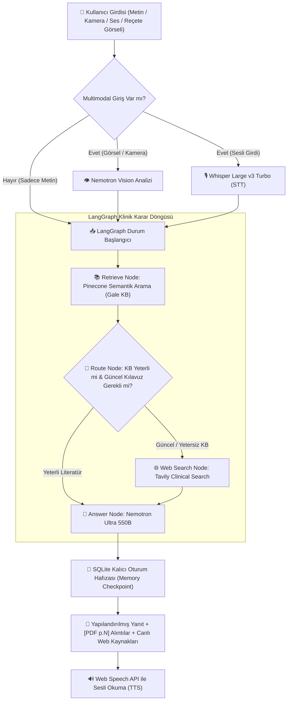

# ⚕️ Novacura AI — Next-Gen Multimodal Medical Decision Support & Triage System

<p align="center">
  
  
  
  
  
  
</p>

---

## 📌 Genel Bakış (Overview)

**Novacura AI**, klinik karar destek ve eğitim süreçleri için geliştirilmiş; **Agentic RAG**, **Çok Modlu Görsel Analiz (Vision)**, **Sesli İletişim (Whisper STT & Web TTS)** ve **Klinik Triyaj Akışı** sunan yeni nesil bir biyomedikal yapay zeka asistanıdır.

Gale Encyclopedia of Medicine literatürünü yüksek boyutlu (3072-dim) semantik vektör uzayında tarar, vakanın aciliyetine veya güncelliğine göre dinamik olarak canlı web taraması (`Tavily Clinical Search`) yapar ve yanıtları klinik belirsizlik prensiplerine uygun olarak kaynak göstererek sunar.

> [!IMPORTANT]
> **Klinik Sorumluluk Reddi:** Novacura AI lisanslı bir hekim veya resmi teşhis aracı değildir. Tıbbi eğitim ve karar destek amaçlıdır. Acil semptomlarda (akut göğüs ağrısı, inme belirtileri, solunum güçlüğü vb.) doğrudan **112 Acil Çağrı Merkezi**'ne başvurulmalıdır.

---

## 🏗️ Sistem Mimarisi & Karar Grafı (Architecture)

Novacura AI, semptomları ve kullanıcı girdilerini **LangGraph** tabanlı döngüsel bir durum makinesi (StateGraph) ile yönetir:



---

## ✨ Temel Yetenekler & Özellikler

| Özellik | Teknoloji & Model | Açıklama |
| :--- | :--- | :--- |
| **Büyük Dil Modeli (LLM)** | `nvidia/nemotron-3-ultra-550b-a55b:free` | 550B parametreli gelişmiş akıl yürütme ve klinik karar analizi |
| **Görsel İnceleme (Vision)** | `nvidia/nemotron-3-nano-omni-30b` | Reçeteler, lezyonlar ve raporlar için objektif medikal betimleme |
| **Ses Transkripsiyonu (STT)**| `openai/whisper-large-v3-turbo` | Türkçe ve çok dilli yüksek doğruluklu ses diktesi |
| **Vektör Bilgi Tabanı** | `Pinecone Serverless` (Cosine, 3072-dim) | Gale Encyclopedia of Medicine (2002) semantik indeksi |
| **Embedding Modeli** | `google/gemini-embedding-001` | 3072 boyutlu medikal semantik gömme |
| **Canlı Web Araştırması** | `Tavily Search API` | En güncel tedavi kılavuzları ve klinik konsensüs taraması |
| **Oturum Hafızası** | `SQLite Checkpoint` (`medical_memory.db`) | Çok turlu hasta diyaloglarında bağlamı koruyan kalıcı hafıza |
| **Erişim Güvenliği** | `Bearer API Token Barrier` | Yetkisiz erişimleri engelleyen güvenlik kalkanı |

---

## 📂 Proje Dizin Yapısı

```bash
AI-Medical-Chatbot/
├── app/
│   ├── __init__.py
│   ├── config.py           # Pydantic tabanlı ortam değişkenleri & SSL yönetimi
│   ├── knowledge.py        # Pinecone bağlantısı, indeks yönetimi & embedding motoru
│   ├── agent.py            # LangGraph klinik triyaj grafı, düğümler ve karar kuralları
│   └── main.py             # FastAPI RESTful API & mikrofon/görsel servisleri
├── data/
│   └── Medical_book.pdf    # Gale Encyclopedia of Medicine kaynak belgesi
├── static/
│   ├── app.js              # Web arayüzü JavaScript istemcisi
│   └── style.css           # Klinik web arayüzü stilleri
├── templates/
│   └── index.html          # FastAPI dahili web arayüzü şablonu
├── .streamlit/
│   └── config.toml         # Streamlit için kurumsal açık klinik tema yapılandırması
├── streamlit_app.py        # Gelişmiş, çok modlu Streamlit klinik kontrol paneli
├── ingest.py               # PDF parçalama (chunking), hash doğrulama ve Pinecone upsert
├── test.py                 # Karar grafı uçtan uca doğrulama testi
├── pyproject.toml          # Bağımlılıklar ve proje meta verileri
├── .env.example            # Örnek ortam değişkenleri şablonu
└── README.md               # Kapsamlı sistem dokümantasyonu
```

---

## 🚀 Hızlı Başlangıç & Kurulum

### 1. Depoyu Klonlayın
```bash
git clone https://github.com/MustafaKocamann/MultiModal-Medical-Assistant.git
cd MultiModal-Medical-Assistant
```

### 2. Bağımlılıkları Yükleyin
Proje paket yöneticisi olarak modern ve hızlı **uv** kullanmaktadır:
```bash
# uv kullanarak bağımlılıkları yükleyin
uv sync
```
*(Alternatif olarak: `pip install -e .`)*

### 3. Ortam Değişkenlerini Yapılandırın
`.env.example` dosyasını `.env` olarak kopyalayın ve API anahtarlarınızı girin:

```bash
cp .env.example .env
```

`.env` dosya içeriği:
```env
# Pinecone
PINECONE_INDEX=medical-agent
PINECONE_API_KEY=pcsk_your_pinecone_api_key

# Web Search
TAVILY_API_KEY=tvly_your_tavily_api_key

# OpenRouter (LLM, Vision, Whisper STT)
OPENROUTER_API_KEY=sk-or-v1-your_openrouter_api_key
OPENROUTER_BASE_URL=https://openrouter.ai/api/v1

# Modeller
OPENAI_CHAT_MODEL=nvidia/nemotron-3-ultra-550b-a55b:free
OPENAI_VISION_MODEL=nvidia/nemotron-3-nano-omni-30b-a3b-reasoning:free
OPENROUTER_STT_MODEL=openai/whisper-large-v3-turbo

# Google Embedding
GOOGLE_EMBED_MODEL=gemini-embedding-001
EMBEDDING_DIMENSION=3072

# Güvenlik & CORS
API_TOKEN=guclu_bir_gizli_anahtar_buraya
ALLOWED_ORIGINS=http://localhost:8000,http://127.0.0.1:8000
```

### 4. Tıp Kitabını İndeksleyin (Ingestion)
Gale Encyclopedia of Medicine kitabını 800 karakterlik parçalara bölüp embedding üreterek Pinecone vektör veritabanına aktarmak için:

```bash
uv run python ingest.py
```

---

## 💻 Kullanım (Arayüz Seçenekleri)

Novacura AI iki farklı kullanım arayüzü sunmaktadır:

### Seçenek A: Profesyonel Streamlit UI (Önerilen)
Kamera erişimi, görsel yükleme, Whisper mikrofon kaydı, sesli okuma ve klinik triyaj filtreleri sunan zengin arayüzü başlatmak için:

```bash
uv run streamlit run streamlit_app.py
```
*Tarayıcınızda açılan ekranda `.env` dosyanızda belirlediğiniz `API_TOKEN` anahtarını girerek oturum açabilirsiniz.*

### Seçenek B: FastAPI REST Sunucusu
Yüksek performanslı REST API ve hafif dahili web arayüzünü çalıştırmak için:

```bash
uv run uvicorn app.main:app --host 0.0.0.0 --port 8000 --reload
```
- **Web UI:** `http://localhost:8000`
- **Swagger / OpenAPI Dokümantasyonu:** `http://localhost:8000/docs`

---

## 📡 REST API Referansı

| Metot | Uç Nokta | Açıklama | Başlık (Headers) |
| :--- | :--- | :--- | :--- |
| `GET` | `/api/health` | Motor ve harici servis bağlantı durumunu döner. | - |
| `POST` | `/api/chat` | Çok turlu klinik karar destek sorgusunu işler. | `Authorization: Bearer <API_TOKEN>` |
| `POST` | `/api/transcribe` | Yüklenen ses dosyasını Whisper ile metne çevirir. | `Authorization: Bearer <API_TOKEN>` |
| `POST` | `/api/speak` | Metni ses sentezine dönüştürür (MP3 akışı). | `Authorization: Bearer <API_TOKEN>` |

### Örnek Sohbet İstek Gövdesi (`POST /api/chat`):
```json
{
  "message": "Astım krizinde ilk basamak müdahale nedir?",
  "history": [],
  "image_data": null
}
```

---

## 🔒 Güvenlik & Uyumluluk Standartları

- **Yetkilendirme:** İstekler `secrets.compare_digest` ile zamanlama saldırılarına (timing attack) karşı korunarak doğrulanır.
- **Hassas Veri İzolasyonu:** `.env` ve SQLite hafıza dosyaları `.gitignore` ile repodan mutlak olarak dışlanmıştır.
- **Güvenli Çok Modlu İnceleme:** Yüklenen görseller yalnızca objektif medikal gözlemler için taranır; tanı iddiasında bulunulmaz.

---

## 📄 Lisans

Bu proje **MIT Lisansı** altında lisanslanmıştır. Detaylar için `LICENSE` dosyasına göz atabilirsiniz.
